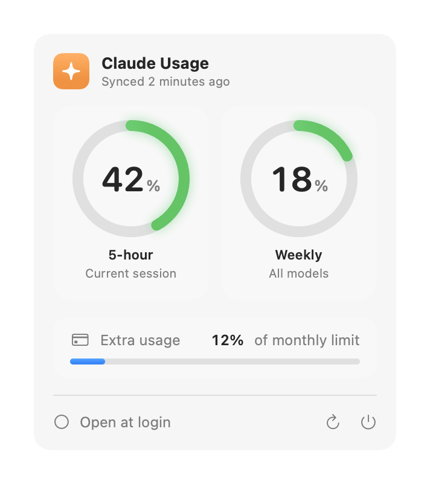

<p align="center">
  
</p>

<h1 align="center">Headroom</h1>

<p align="center">
  See how much of your Claude plan you have left, right from the menu bar.
</p>

<p align="center">
  <picture>
    <source media="(prefers-color-scheme: dark)" srcset="docs/screenshot-dark.png">
    
  </picture>
</p>

## Features

- **Always visible.** Your 5-hour usage sits in the menu bar, like `✦ 42%`.
- **One click for the details.** Ring gauges for the 5-hour and weekly limits,
  plus extra usage if you have it turned on.
- **Color coded.** Green, then orange from 50%, then red from 80%.
- **Private by design.** No login, no network requests, no tokens used.
- **Starts with your Mac.** Turn "Open at login" on or off from the popover.

## Install

Paste this into Terminal:

```bash
curl -fsSL https://raw.githubusercontent.com/ontckr/Headroom/main/install.sh | bash
```

It downloads the latest release, moves `Headroom.app` into Applications, and
opens it. Look for **✦** in your menu bar. You can read
[the script](install.sh) first; it is about 20 lines.

<details>
<summary><strong>Prefer to install by hand?</strong></summary>

1. Download `Headroom.zip` from the
   [latest release](https://github.com/ontckr/Headroom/releases/latest).
2. Unzip it and drag `Headroom.app` into your Applications folder.
3. Open it. macOS will say it can't verify the developer, because Headroom is
   not notarized by Apple. Click **Done**.
4. Open **System Settings → Privacy & Security**, scroll down, and click
   **Open Anyway** next to the message about Headroom.

You only need to do this once.

</details>

### Requirements

- macOS 14 Sonoma or later, on Apple silicon or Intel
- The [Claude desktop app](https://claude.ai/download), signed in to a Pro or
  Max plan

## How it works

The Claude desktop app keeps a record of your plan usage on your Mac:

```
~/Library/Application Support/Claude/plan-usage-history.json
```

Headroom reads the newest entry and updates as soon as the file changes. It
never contacts Anthropic, never asks for your password, and never touches your
Claude login.

### Why is my number a little behind?

The Claude app adds a new entry roughly every 5 to 30 minutes while you use
it, so Headroom can trail the number Claude shows by a few points. The popover
tells you when the data was last synced.

### Why does a gauge show "–"?

That usage window has reset since Claude last recorded your usage, so the old
number no longer applies. It fills in again the next time Claude records an
update.

## Build from source

You need Xcode 16 or later.

```bash
git clone https://github.com/ontckr/Headroom.git
cd Headroom
make install
```

| Command        | What it does                                    |
| -------------- | ----------------------------------------------- |
| `make build`   | Build a universal release app into `build/`     |
| `make run`     | Build and open it                               |
| `make install` | Build and copy it to `/Applications`            |
| `make zip`     | Build and package `build/Headroom.zip`          |
| `make clean`   | Remove build output                             |

## Disclaimer

Headroom is an independent project. It is not affiliated with, endorsed by, or
supported by Anthropic. It reads a file the Claude app uses internally, which
may change in a future Claude update.

## License

[MIT](LICENSE)
